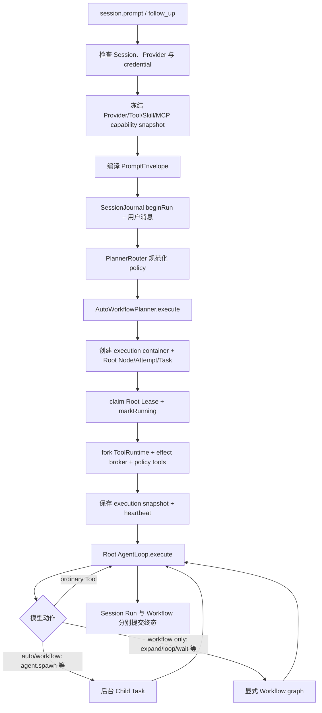

# RuntimeKernel、Planner 与 AgentLoop 当前主链路

最后核对：2026-08-22。本文只描述当前产品路径；历史 Plan/DAG 库不作为第二套根 Planner 介绍。

第一次阅读 Praxis 时，可以先记住一句话：`RuntimeKernel` 负责组装，`AutoWorkflowPlannerV1` 负责建立持久执行边界，
`AgentLoop` 负责一个 AgentTask 内的 ReAct，`Workflow Authority` 负责跨进程保存执行事实。

## 1. 四个模块各管什么

| 模块 | 当前责任 | 明确不负责 |
| --- | --- | --- |
| `RuntimeKernel` | RPC、Session、能力快照、服务组装、终态回调 | 不实现每个领域的算法 |
| `AutoWorkflowPlannerV1` | Root execution container、Root Task/Lease、Tool surface、snapshot、终态 | 不逐 Turn 选择模型动作 |
| `AgentLoop` | Prompt 装配、Provider stream、Tool call、usage、steer、compaction、唯一终态 | 不直接改 Workflow graph 或 claim Child Task |
| `WorkflowOrchestratorV1` | 把 start/admit/complete/reconcile 转成 authority 事务 | 不解释自然语言，也不生成用户答案 |

**execution container** 是一次 Run 的持久执行外壳。默认 `auto` 内部仍用 Workflow 记录 Root、Child、Task、Lease、
消息和 Artifact 引用，但模型不需要把工作思路编写成 DAG。

## 2. Composition Root

`RuntimeKernel` 构造并连接：

- `SessionRepositoryV3`、`SessionService` 与 `RunCoordinator`；
- `SqliteWorkflowAuthorityV1` 或认证的远程 Workflow Authority；
- `PlannerRouter` 与唯一 Root 实现 `AutoWorkflowPlannerV1`；
- `AgentLoop`、`ProviderRouter`、`ToolRuntime` 与 `PolicyEngine`；
- Credential、Artifact、Trace、Skill、MCP、Plugin 和 Process activation；
- `DurableWorkflowWorkerServiceV1` 与 `LocalWorkflowAgentWorkerV1`。

**Composition Root（组合根）** 是集中创建对象并把依赖接起来的位置。算法仍留在各模块中，因此 Provider、Session 后端
或 Workflow Authority 可以替换，而不会把所有逻辑复制进 Kernel。

父 Runtime 启动时初始化 Session backend 和 Workflow Authority，并恢复过期 Lease。受授权 Child Runtime 携带
`RuntimeAuthority`，使用独立临时 Session/Trace/Artifact 根，不直接打开父 Workflow SQLite，也不能处理父协议的全部方法。

`RuntimeKernelOptions.middleware` 是可信宿主扩展点。`beforeModel/afterModel` 包围一个逻辑 Provider turn；
`beforeTool/afterTool` 包围 Tool 边界。before hooks 正序、after hooks 逆序。Tool name/input 修改在 schema、target、
权限和 effect broker 之前完成，不能利用旧目标授权新目标；非法返回或 hook 异常以
`RUNTIME_MIDDLEWARE_FAILED` fail-closed。完整合同见 [Runtime Middleware](../../../docs/runtime-middleware.md)。

## 3. Root 与 Child 使用的 Planner 路径

当前只有一个 Root 产品 Planner：

```text
Root Prompt
  → PlannerRouter 解析 auto|solo|workflow
  → AutoWorkflowPlannerV1
  → Root AgentLoop

已准入 Child AgentTask
  → Child bootstrap
  → AgentTaskPlanner
  → Child AgentLoop
```

`PlannerRouter.select()` 对三个 policy 都返回同一个 `AutoWorkflowPlannerV1`。`AgentTaskPlanner` 是内部薄 adapter，
只把已经准入的 Child execution 交给 AgentLoop；它不是 Direct 产品模式，也不重新生成外层 Plan。

`packages/core-sdk/src/plan.ts` 与 `apps/runtime/src/planner/` 中的 `PlanGraphV1`、PlanGenerator、DAG/Serial Supervisor、
ReplanCoordinator 仍可作为库和测试资产。当前 Root Prompt 不先调用它们生成 PlanGraph；判断产品路径应从
`RuntimeKernel.requirePlanner()` 反向追踪，而不是只看 export 或目录名。

## 4. 一条 Prompt 的真实调用顺序



Session 的 `beginRun` 发生在 Planner 之前，因此即使 Planner 初始化失败，用户输入和 Run 失败仍有 Session 事实可审计。
Root Planner 启动后会把 `workflowId` 和 `finalizeWorkflow` callback 绑定到当前 Run。

Root 结束时，AgentLoop 的 `finishRun` callback 先让 RunCoordinator 提交 Session 终态和 usage，再调用
`finalizeWorkflow` 完成 Root Attempt/Node/Task。两套 authority 通过 ID 关联，但不是一个跨库事务。

## 5. Policy 决定 Tool surface

| Policy | 模型可见协作 Tool | 当前语义 |
| --- | --- | --- |
| `auto` | `agent.spawn/wait/result/cancel/steer` | 默认；plan-guided ReAct + 增量 Agent Run Tree |
| `solo` | 无协作 Tool | Child Budget 为 0；其余仍走同一执行链 |
| `workflow` | Run Tree Tool，再加 delegate/handoff/expand/inbox/join/loop/wait/subworkflow | 显式粗粒度 DAG 和持久业务编排 |

旧 `direct` 与 `supervisor` 只在解析期迁移为 `solo` 与 `workflow`。

`workflow` policy 还通过 effect broker 强制：在 topology 仍为 `single_agent` 时，普通 write、process、network Tool
返回 `WORKFLOW_TOPOLOGY_REQUIRED`。`auto` 没有这项“先图化再副作用”的限制。

v4 默认累计执行预算使用内部 unlimited 编码；用户、CLI、组织策略或显式 Workflow Node 仍可设置 Budget 与 deadline。
这不取消 context window、权限、协议校验和本地容量限制。Local Worker 同时活跃 Child 的资源容量当前为 256，
它限制瞬时并发，不限制整个 Run 生命周期累计能创建多少 Child。

运行限制必须按“累计任务配额”和“单次操作安全边界”分开：

| 类型 | v4 默认 | 原因 |
| --- | --- | --- |
| 累计 Provider turns、Tool calls、tokens、wall clock、Child 数、depth、loop/graph mutations | 不设产品默认上限；只有调用者显式设置才生效 | 这些值不能代表通用长任务的合理寿命 |
| Harbor 等外层 benchmark timeout | 保留在评测器，不注入 Praxis | 统一计时、判定无效样本和回收隔离容器 |
| Provider context/output window | 保留 | 上游模型协议的真实容量，超出后请求本身无效 |
| Tool inline bytes、journal frame、IPC/schema 大小 | 保留，并用分页或 Artifact overflow 承接大结果 | 防止单帧内存放大、协议阻塞和损坏持久日志；它限制传输，不限制总任务产物 |
| SQLite lock/Lease/heartbeat、Provider 单次请求 deadline、有限 retry | 保留 | 防死锁、重复副作用和永久等待坏连接 |
| Local Worker / Provider lane 并发 | 保留 | 限制同一时刻的资源占用，不限制累计工作量 |
| 64K replay compaction 触发、4K checkpoint 上限 | 保留 | 控制每轮重复上下文成本；压缩工作集，不结束 Agent Run |

所有“无限” deadline 经过 `canonicalDeadlineAfter()` 编码，并用 `scheduleLongDurationTimer()` 分段重挂，不能把超出
Node 原生约 24.8 天范围的 delay 直接传给 `setTimeout`。Root、Child host、Shell 和 credential broker 均遵守这条规则；
否则底层 timer 会把超长 deadline 溢出成约 1 ms，形成隐式假超时。

同理，Child `session.prompt.timeoutMs` 是写入 Child Run 的耐久预算，不是原生 timer 参数，必须传递完整的剩余
deadline，不能为了迁就 `setTimeout` 截到 2,147,483,647 ms。真正需要 arm timer 的地方再由长定时器分段；否则
v4 的 unlimited Child 会被静默改写成约 24.8 天的有限任务。

## 6. 默认 `auto`：Agent Run Tree

默认 `auto` 不向模型开放完整图编辑。Root 用稳定 Child 句柄增量调整路线：

- `agent.spawn`：持久创建一个 background Child，立即返回 `childId`；
- `agent.result`：非阻塞读取状态和 `resultRef`，默认确认终态消息；
- `agent.wait`：对选定句柄执行 `all/any/quorum` Durable Future 等待；
- `agent.steer`：先持久化 instruction，再交付给活跃或尚未启动的 Child；
- `agent.cancel`：取消失去价值的分支，保留历史与已有证据。

`agent.spawn` 创建的内部 Node 带 `required=false` 和 `coordinationMode=background`。前者把 Child 视为可选证据：失败或
取消不自动使外层执行失败；后者允许 Worker 在 Root 仍活跃时领取它。外层仍实行结构化并发：所有 background Child
必须终态，Root 必须用 result/wait 消费终态消息，才允许输出最终答案。

Run Tree Child 的数值 Budget 不由模型填写，而是继承父 Run 与组织执行策略。模型仍可请求目标、harness、Tool/Skill/MCP
子集、workspace、network、model class、reasoning、返回 Schema 和成功标准；Runtime 做最终裁剪。

当前第一阶段的 Child Session 固定为 `solo`，所以 Root 可以有多个 Child，但 Child 还不能继续 spawn descendant。
后续若开放递归，必须经过父 Runtime 的受认证 spawn broker，不能允许 Child 启动嵌套 Praxis CLI 绕过 ancestry 与账本。

## 7. 显式 `workflow`：完整业务 DAG

显式 `workflow` policy 额外提供：

- `agent.delegate`：同步等待一个 required Child；
- `agent.handoff`：把责任交给 synthesis Node；
- `workflow.expand`：提交带依赖的多 Agent 图，Root 选 `wait` 或 `continue`；
- `workflow.inbox/join`：读取持久 mailbox 或按 all/any/quorum 汇合；
- `workflow.loop`：用连续 GraphPatch 展开有界无环迭代；
- `workflow.wait`：创建 HumanTask 或 Timer；
- `workflow.subworkflow`：创建独立 Workflow ID 的子 Workflow。

模型提交的是 Proposal，不是 authority。Orchestrator 校验 mode、revision CAS、DAG 无环、依赖、Profile、Grant、
Capability、Budget、结果 Schema、成功标准、retry 与 effect 合同，然后才在同一事务中写 Graph、Attempt、Task 和 Outbox。

显式 Node 默认 required。`all` 要求所有分支成功；`any/quorum` 的成功 Join 是持久事实，可以让少数失败或取消分支
不再影响外层成功。Scheduler 只从 Node/Edge/projection 重新推导前沿，因此重启后不依赖原 Tool 调用栈。

## 8. Workflow Authority 中的执行对象

| 对象 | 作用 |
| --- | --- |
| `WorkflowSpecV1` | 目标、policy、topology、Node/Edge、预算和完成规则 |
| `WorkflowProjectionV1` | 事件归并后的 Workflow/Node/Attempt 当前状态 |
| `WorkflowTaskV1` | Worker 可领取的持久工作记录 |
| `WorkflowTaskLeaseV1` | workerId、随机 token、heartbeat 和 expiry |
| Workflow Event | append-only 状态事实 |
| mailbox Message | Root、Child、用户或 Runtime 之间可确认的协调消息 |
| Artifact reference | 指向完整结果、证据、execution snapshot 或 receipt |

本地 SQLite 关键表包括 `workflows`、`workflow_events`、`workflow_transactions`、`workflow_tasks`、
`workflow_outbox`、`workflow_messages`、`workflow_timers`、`workflow_signals`、`workflow_human_tasks` 和
`agent_profiles`。Create、transact、claim 与 recovery 使用事务；`expectedSequence` 提供 CAS。

本地写事务使用 `BEGIN IMMEDIATE`，在事务开始时取得写权限，避免执行到一半才发现另一个写者已经抢先修改。

**mailbox** 供 Agent 协调；**Outbox** 供基础设施可靠发布 Task/通知。Child 终态的 Node/Attempt/Task 与 Root 收件的
`result/error` 在同一 authority 事务提交，完整正文进入 ArtifactStore，消息只携带有界元数据和 `resultRef`。

## 9. Child Runtime 与能力衰减

Child 是 `ChildRuntimeHost` 启动的受认证 Runtime 进程，不是线程或追加 Prompt。它获得：

- 签名 ContextPacket 与 bootstrap profile；
- 独立临时 Session、Trace 和 Artifact 根；
- 收窄后的 Capability Bundle；
- Provider credential broker 的短期 handle；
- 父 ToolRuntime 提供的 MCP/process/API brokered view；
- 明确 workspace、deadline、结果 Schema 和成功标准。

有效能力取交集：

```text
父 capability snapshot
∩ Workflow Grant
∩ Agent Profile allowlist
∩ Node request
∩ Policy / permission
= Attempt Capability Bundle
```

Credential handle 不把 API key 放入 Child 环境、Prompt 或 Artifact。Child 调用父 broker 时仍经过 Tool Schema、权限、
冲突控制、Workflow Activity 和 receipt；能力不会因为跨进程而扩张。

## 10. Effect 与可写 Child

Root 的可变 Tool 先经过 Workflow effect broker。幂等外部动作在调用前 reserve；成功后保存 receipt；不能确认是否发生
的非幂等动作进入 `unknown`，不能盲重试。补偿引用已经 committed 的外部 receipt，不由模型文字改写账本。

`workspace_write` Child 不直接写主目录：

- Git workspace：detached worktree → 候选 commit → base/patch/path/digest 校验 → `--ff-only` 合并；
- 非 Git workspace：私有快照 → 基线摘要与授权范围校验 → 单写锁回写；
- 校验失败保留 recovery path，不把未经验证的候选变化写回主目录。

workspace 隔离和 verifier 位于 `src/planner/`，这是该目录仍在当前 Worker 主链中活跃的部分。

## 11. 终态、Lease 与恢复

Root Task 由 Planner 立即 claim，并每 30 秒 heartbeat。后台 Child 由 `DurableWorkflowWorkerServiceV1` 扫描 ready Task，
按 Provider capacity 领取。只有持有匹配 lease token 的 Worker 才能更新 Task。

Lease 过期后：

- pure/read/idempotent 工作可在 RetryPolicy 与 Budget 内创建新 Attempt；
- workspace write 或非幂等副作用不会盲重试；
- 无法确认结果时进入 `unknown` 或 `manual_intervention`；
- 已成功 Node 保持原 Attempt，不因后继失败而重跑。

Root 准备结束时，AgentLoop completion guidance 检查 background Child：未终态时要求 `agent.wait`；终态结果未确认时
要求 `agent.result` 或 `agent.wait`。Root 成功后，`workflowSettlement()` 仍等待所有 descendant 终态；
`required=false` 的 Run Tree Child 失败不否定 Root，显式 required Node 的未吸收失败会令 Workflow 失败。

Worker 启动或节点完成时会调用 `reconcileWorkflow()`，只根据持久 projection 重新推导 ready 前沿、Join 和最终结算。
并发提交遇到 sequence 冲突时重新读取再算；成功节点不重复执行，被中断节点才创建新 Attempt。

## 12. Session、Prompt 与 Compaction 的边界

Session authority 可选 JSONL V3 或 SQLite V3，一次 Runtime 只选一个，不双写。Session 保存对话、Run、usage、分支与
compaction；Workflow authority 保存 Node、Task、Lease、消息、能力快照和副作用事实。

父 Agent 的 ContextBuilder 使用 SessionJournal 派生的 `ContextView`。RuntimeKernel 先固定本次 Root/Child Run 的逐字
task contract，PromptAssembler 再选择 Child 可选签名 ContextPacket、checkpoint、近期消息和 Provider-specific native
context；逐字合同与 canonical live message 去重，并位于 compaction cut 之外。Tool definitions 作为独立 Provider 字段
发送。Compaction 只改变以后给模型看的工作记忆，不压缩或重建 Workflow projection。执行恢复永远依据 Workflow
journal，不依据自然语言 summary。

精确装配顺序见[Prompt、Context 与 Compaction](../../../docs/prompt-assembly.md)。

## 13. 入口文件

| 文件 | 作用 |
| --- | --- |
| `src/framework/runtimeKernel.ts` | 产品 composition、RPC、Run 建立和终态回调 |
| `src/planner-api/index.ts` | 最小 Planner 接口 |
| `src/planner/plannerRouter.ts` | policy 解析和 legacy alias 迁移 |
| `src/workflow/autoWorkflowPlanner.ts` | 唯一 Root Planner 实现 |
| `src/workflow/agentRunTreeTools.ts` | 默认 spawn/wait/result/cancel/steer |
| `src/workflow/workflowOrchestrator.ts` | admission、事务和状态推进 |
| `src/workflow/durableWorkflowWorkerService.ts` | 后台 claim、执行与恢复 pump |
| `src/workflow/sqliteWorkflowAuthority.ts` | 本地 SQLite Task/Lease/Event authority |
| `src/workflow/localWorkflowAgentWorker.ts` | Child、broker、worktree/snapshot merge |
| `src/subagent/childRuntimeHost.ts` | 受认证 Child 进程 host |
| `src/planner/agentTaskPlanner.ts` | Child AgentLoop adapter |
| `src/loop/index.ts` | 单 AgentTask 的 ReAct 与终态 |

## 14. 当前边界

当前已接入默认 `auto` Agent Run Tree、spawn/wait/result/cancel/steer、显式 Workflow DAG/loop/subworkflow/wait、
SQLite 与认证远程 Authority、Task/Lease/recovery、不可变 execution snapshot、持久 mailbox、隔离写合并、effect broker
和 Artifact 结果。真实测评边界与修复记录以[项目状态](../../../docs/project-status.md)和
[持续维护的测评档案](../../../docs/evaluations/README.md)为准。

当前未接入任意层级递归 Child、PostgreSQL Authority、租户级分布式熔断、高可用通知渠道和连接器声明驱动自动补偿。
这些边界不能从类型名、历史 RFC 或单次 smoke 推断为已经交付。
