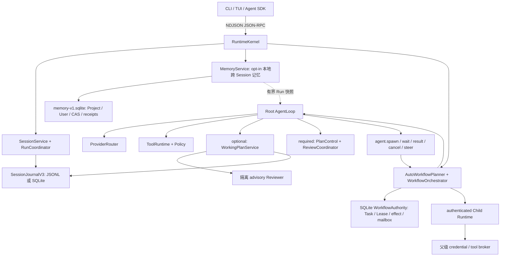

# 当前架构

核对日期：2026-09-06。本文描述已接线代码，不是目标设计。English summary: one execution runtime, separate conversation and execution authorities, optional model-owned plans and local cross-session memory.

## 1. 总览

模型决定“接下来尝试什么”；Runtime 决定“是否获准、是否真实发生、如何保存和恢复”。模型的工作清单、执行记录、验收决定不是同一对象。

## 2. 进程与组合根

`apps/cli` 启动独立 Runtime，只负责请求、事件和界面；不直接执行 Provider 或工具。stdout 专用于协议，诊断写 stderr。Agent SDK 使用同一协议边界。

`framework/runtimeKernel.ts` 是 Composition Root：组装 SessionService、RunCoordinator、AutoWorkflowPlannerV1、WorkflowOrchestratorV1、SqliteWorkflowAuthorityV1、AgentLoop、ProviderRouter、ToolRuntime、权限、扩展、Artifact 和 Trace，并分发 RPC。

默认计划由 WorkingPlanServiceV1 + ProviderAdvisoryReviewerV1 提供；required 则组装 PlanControlServiceV1 + ReviewCoordinatorV1 + ProviderSemanticReviewerV1。二者共用持久审查调用存储 ReviewCallStoreV1，但工具 Schema、Prompt 和完成语义不同。

Root 另组装 MemoryServiceV1，提供 `memory.manage`、按项目模式开放的 `memory.*` Tool 和有界召回。新项目默认 off，Child 不打开父记忆库。它独立于会话压缩，也不会把记忆内容升级为权限或验收证据。

## 3. 统一执行，不等于统一计划合同

| 选择 | 模型看到什么 | 执行方式 |
| --- | --- | --- |
| auto + optional（默认） | 普通 Tool、五个 Working Plan Tool、Child 句柄工具 | 自主 ReAct；可不建 Plan |
| solo + optional | 普通 Tool、五个 Working Plan Tool | 同一循环，禁止 Child |
| auto/solo + required | 普通 Tool、严格 ReviewPlan Tool；auto 可派 Child | Host 要求 Plan 和严格验收 |
| 显式 workflow | legacy 图编排和协作工具 | 同一执行底座；不能与 required 混用 |

`direct → solo`，`supervisor → workflow`，只作兼容别名。`PlannerRouter` 解析策略，而不是在两套 Runtime 间路由。

每次 Prompt 都建立内部 execution container、Root Node、Attempt、Task 和 Lease，用于恢复与调度。即使没有调用 `plan.create`，这些执行事实也存在；它们不是模型编写的 DAG。普通 Plan 只有创建后才持久化。详见[Working Plan](working-plan.md)。

## 4. 状态分别放在哪里

| 存储 | 保存什么 | 不负责什么 |
| --- | --- | --- |
| SessionJournalV3：JSONL 或 SQLite | 消息、Run、分支、checkpoint、Working Plan、Review 请求/报告引用、严格 Plan 事件 | 不从自然语言推测工具执行结果 |
| SQLite WorkflowAuthority | Node/Attempt/Task/Lease、执行快照、mailbox、预算、effect reservation、Timer/HumanTask 等 | 不保存模型完整认知路线 |
| ReviewCallStore：SQLite | 隔离模型审查的调用尝试、用量、失败诊断与恢复状态 | 不独自证明产物正确 |
| MemoryService：memory-v1.sqlite | 跨 Session 项目/User 记忆、revision、幂等回执、撤销记录与 Session 暴露关系 | 不自动学习、不做向量检索，不替代 Session/Workflow 账本 |
| ArtifactStore | 内容寻址的长结果、证据和审查输入/输出 | 不自动成为可信成功证明 |
| Trace | 关联诊断与观测 | 不替代领域 Journal 的执行权威 |

同一 PRAXIS_HOME 数据根由 session-authority.json 认领一个 Session 后端，不是每个 Session 可以随意混选；不双写，默认 JSONL，切换通过离线校验迁移。JSONL 通过已校验 Catalog/Projection 快速启动，`doctor --deep` 才完整重放。因此“Session 使用 JSONL”不代表整个产品不使用 SQLite。

Workflow Authority 可通过带 Bearer 认证的 HTTP RPC 提供远程访问；远程 Runtime 不直接共享 SQLite 文件。配置入口是 `PRAXIS_WORKFLOW_AUTHORITY_LISTEN/TOKEN/URL`。这是现有单写入点协议，不是 PostgreSQL authority 或高可用集群。

## 5. Child、权限与工作区

Child 是实际的 Subagent：独立 Runtime 进程、Session、上下文、Provider/Tool loop。Root 不自动继承其全部 transcript 或隐藏 reasoning，只收到持久结果、错误和 Artifact 引用。

Capability Bundle 是授权快照，来自父权限、Profile、节点请求和 Policy 的交集。Child 不能通过 Runtime 工具与 broker 接口扩大路径、网络、工具或凭据授权。凭据通过短期 credential broker handle 使用；MCP/Process 工具可通过父 ToolRuntime broker 调用。此约束不是任意子进程的 OS 沙箱；Shell/MCP 的系统访问边界见[威胁模型](security-threat-model.md)。

当前 Child 固定 solo，不能再创建 Child。Root 可以动态 spawn 多个 Child，持久 wait all/any/quorum，发送 steer 或 cancel。真实 Child 必须收敛并消费结果，不能通过把 Plan 标 done 绕过生命周期。可选 Child 的失败本身不自动否定 Root 成果。

写入隔离有两种实现：Git 工作区使用 detached Git worktree，父侧校验候选提交、patch、scope、digest 和基线后 fast-forward；非 Git 工作区使用受管目录快照和摘要校验回写。失败保留 recovery path。Root 普通 write/edit 在主工作区执行，语义不同。

## 6. Tool 与外部副作用

Builtin、MCP stdio 和 Process 工具统一经过 Schema、权限、路径、冲突调度和输出预算。Skill 是可加载指令，不是提升权限的脚本执行后门。

可变外部工具进入 WorkflowEffectBroker。幂等 reservation 在调用前落盘，成功结果保存 receipt；同一幂等身份的重试可重放已提交结果，键与输入不匹配则拒绝。工作区写入的自动键绑定 Runtime invocation，新的调用即使参数相同也会执行；例如 A→B→A 必须真正恢复 A。没有 invocation 的内部调用使用新键，不能仅凭内容相同猜测重试。显式外部 idempotencyKey 的语义保持不变。结果未知的非幂等动作不能假装失败后盲目重试。默认 Working Plan 不要求工具绑定 Plan Item Attempt；required 保留该约束。

本地 `memory.upsert/forget` 仍经过工具权限，但使用 MemoryService 自己的事务、CAS 和回执，不进入 Workflow effect 或严格 Plan Item 执行账本。持久化是按领域分别保证的，不是跨所有 SQLite 文件的同一事务。

## 7. Prompt 与模型调用

默认 `iron-law-lean-v1` 1.3.0。固定 Trusted Instructions、运行事实、Skill/项目资料、逐字任务、动态 Plan、稳定 ContextView 和最近消息分段装配。Tool Schema 使用独立字段。压缩只改变后续模型视图，不删除原始 Journal。

咨询 Reviewer 使用冻结输入，不读取实时工作区或隐藏测试。原生 structured output 用空 tools；不支持时使用受限提交工具，不等于开放普通 Tool 权限。optional 的 supported/concern/unknown 只是意见；required 使用严格 proof/decision 合同。详见[装配规则](prompt-assembly.md)和[请求目录](model-request-catalog.md)。

## 8. 恢复与边界

Lease 表示某 Worker 暂时拥有某 Task。过期后 Runtime 根据 effect、RetryPolicy 和已提交状态决定接管、重试或人工处理，而不是重跑整个任务。Checkpoint 保存上下文连续性，不能替代执行账本，也不保证模型记忆绝不出错。

没有内置公共 Web Search、完整浏览器、任意递归 Child、PostgreSQL authority 或多租户 SLA。本地跨 Session Memory Store 已接线，当前是 opt-in、显式写入和关键词召回，完整合同见[本地长期记忆](long-term-memory.md)。已验证的题目和恢复实验见[测评档案](evaluations/README.md)，不能从类型或表结构推出效果。细节边界见[项目状态](project-status.md)。
