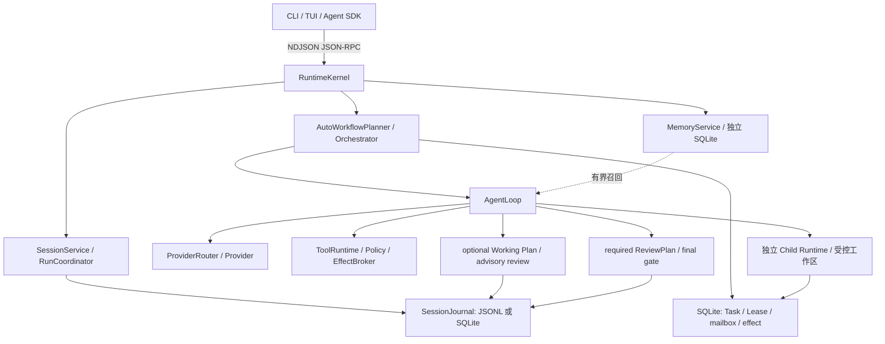

# Praxis Harness 源码审计与框架比较

调研日期：2026-09-06。English summary: a source-grounded audit of Praxis and a dated comparison with current agent frameworks. Architecture evidence is not a claim of benchmark superiority.

## 1. 判断与范围

**Praxis 最值得保留的定位，是模型中立、面向本地长任务、重视执行事实与恢复的 Agent Runtime。** 它已经具备独立协议进程、可嵌入 SDK、真实 Child、持久执行账本和上下文管理，明显超出了简单的 API/Prompt 包装。最有价值的组合是：模型自主改变计划，Runtime 独立管理权限、执行、回执、等待与恢复。

但是，多模型、规划、MCP、子 Agent、压缩、会话恢复在当前市场都不是独有功能。相对成熟项目，Praxis 的优势更集中在执行语义的可检查性、明确的副作用未知状态和本地能力控制；生态、即用工具、部署面、质量统计和维护成本仍有明显短板。不能依据已有代码或少量成功任务，宣称它比主流框架普遍更强。

本次实际检查了 `D:\praxis` 当前工作区的入口、公共合同、Kernel/Loop、工作计划/严格审查、Workflow SQLite/effect、Child/工作区、上下文、长期记忆、工具/扩展、安全和测试。审计起点 Runtime 共 209 个 TypeScript 文件、约 65,582 个非空行，测试目录有 163 个测试文件；修复后另新增一个进程解析测试文件。这些只是规模信息，不是质量分数。并非对所有源码逐行进行完备安全审计。

Git HEAD 为 `a25770b`，日期 2026-09-02；调研开始前工作区已有大量未提交修改和新增目录。新 Working Plan、ReviewPlan、长期记忆等结论针对**本地源码**，不能直接等同于 HEAD、已发布包或全局安装的 `praxis`。按用户授权，本次修复了两项可复现缺陷并补回归测试，同步修订文档；没有提交、发布版本或全局安装。

外部资料使用当天实际获取的官方文档及官方仓库。部分网页是滚动版本，未给出可冻结的 SDK 版本；本报告记录访问日期和来源，不伪造版本号。没有安装并实跑所有竞品，比较矩阵是功能与工程取舍分析，不是同模型排行榜。网页搜索接口中途不可用后，直接通过 HTTPS 获取官方页面继续核对。

最终源码/测试/根配置的 499 文件摘要及六份原始 Benchmark 的数值摘录与 SHA-256 见[审计证据清单](harness-audit-evidence-20260906.json)。聚合摘要为 `22d2b3596b3250318ae8db94c398608667e7a02d418052fee40c92e07853c298`，算法和纳入范围写在清单中。它定位未提交源码快照，不代替发布签名、完整源码归档或 CI 认证。

## 2. 从源码还原真实系统

这里有四种需要分清的状态：Session 保存对话和计划；Workflow 保存执行事实；ReviewCallStore 保存辅助模型调用；MemoryService 保存跨 Session 经验/偏好。它们分工清楚，但不构成跨所有存储的统一原子事务。

| 实际路径 | 代码依据 | 审计结论 |
| --- | --- | --- |
| 产品入口和组合 | [run.ts](../../apps/runtime/src/run.ts)、[runtimeKernel.ts](../../apps/runtime/src/framework/runtimeKernel.ts) | 独立 Runtime 与可信 Host 注入点；不是 CLI 直接调所有工具 |
| 默认执行 | [autoWorkflowPlanner.ts](../../apps/runtime/src/workflow/autoWorkflowPlanner.ts) | auto/solo 共用执行账本；默认不要求模型先写 DAG；显式 workflow 才提供 legacy 图工具 |
| 模型与工具循环 | [loop/index.ts](../../apps/runtime/src/loop/index.ts)、[toolRuntime.ts](../../apps/runtime/src/tools/toolRuntime.ts) | 请求/结果、权限、冲突、输出预算和终态形成闭环 |
| 默认计划 | [workingPlanService.ts](../../apps/runtime/src/working-plan/workingPlanService.ts) | 清单可改、重开、放弃，done 是自报进度；咨询失败不自动阻断执行 |
| 严格计划 | [rootToolExecutionBroker.ts](../../apps/runtime/src/review-plan/rootToolExecutionBroker.ts)、[registeredChecks.ts](../../apps/runtime/src/review-plan/registeredChecks.ts) | 仅 required 绑定 Item Attempt；检查器由 Host 注册且绑定版本/digest，模型不能自传可执行验收脚本 |
| 执行持久性 | [sqliteWorkflowAuthority.ts](../../apps/runtime/src/workflow/sqliteWorkflowAuthority.ts)、[workflowEffectBroker.ts](../../apps/runtime/src/workflow/workflowEffectBroker.ts) | WAL/FULL、BEGIN IMMEDIATE、租约身份、幂等 reservation、回执、unknown 状态均有实现 |
| Child | [childRuntimeHost.ts](../../apps/runtime/src/subagent/childRuntimeHost.ts)、[childComposition.ts](../../apps/runtime/src/subagent/childComposition.ts) | 真进程与独立上下文，签名 bootstrap/能力集合；当前 Child 不再 spawn |
| 写隔离 | [controlledWorkspaceMerge.ts](../../apps/runtime/src/planner/controlledWorkspaceMerge.ts)、[directoryWorkspaceIsolation.ts](../../apps/runtime/src/planner/directoryWorkspaceIsolation.ts) | Git 候选校验/受控合并；非 Git 快照与摘要校验回写 |
| 长上下文 | [promptAssembler.ts](../../apps/runtime/src/prompt/promptAssembler.ts)、[compactionService.ts](../../apps/runtime/src/memory/compactionService.ts) | 逐字任务与动态计划在可压缩历史外；Provider 视图编辑不改原始 Journal |
| 本地长期记忆 | [memoryService.ts](../../apps/runtime/src/long-term-memory/memoryService.ts)、[memoryContext.ts](../../apps/runtime/src/prompt/memoryContext.ts) | 已接入，默认关闭；独立 SQLite、关键词召回、显式写入、CAS 和撤销检查 |

## 3. 真正的亮点和相应代价

### 3.1 将“模型说做了”和“系统确实执行了”分开

普通工作清单与 Task/Lease/effect 不互相冒充：模型可以把一步标 done，但这不会代替工具结果、结束活跃 Child，或让 required 的验收自动通过。修改清单也不会隐式撤销已经发生的外部动作。

这个划分有助于长任务诊断。出错时可以区分计划不合理、工具未获准、动作结果未知、审查误判、最终题目失败，而不是统称“Agent 没做好”。代价是状态类型、协议、持久化和 UI 投影数量较多。

### 3.2 对不确定副作用的处理比简单重试循环细致

EffectBroker 在适用调用前预留幂等身份，已提交结果可从 Artifact 回执重放；同键不同输入拒绝。工具返回错误结果，与进程/网络动作已经开始但未返回，走不同状态。后者进入 unknown，避免把“没收到结果”当成“动作没发生”。本次也查出了原实现错误地按内容去重工作区写入的问题，已修复为按 invocation 区分新操作与重试，详见第 8 节。

[effect 测试](../../test/workflow-effect-broker.test.ts)覆盖已知失败、抛错未知结果、重复调用不重复作用、补偿回执；[SQLite 测试](../../test/workflow-sqlite-authority.test.ts)覆盖重启、过期 Lease、安全与非幂等动作的不同恢复。**这是本项目最值得独立展示的工程能力之一。** 但外部系统与本地数据库没有共同事务，仍不承诺任意 API exactly-once。

### 3.3 多 Agent 不只是 Promise.all

Child 的能力来自父权限/Profile/请求/策略求交；bootstrap 有身份绑定，凭据经 broker，外部 Tool 可回到父级受控调用链。Root 的 wait/result/steer/cancel 与持久 mailbox 相连。工作成果经受控工作区验证后处理，失败可保留恢复材料。

这适合长时间代码任务、相互独立的修改或需要审计的委派。代价是进程启动、上下文重建、凭据代理、证据传递和合并成本。当前只有 Root 加一层 Child；不能把 maxDepth 类型或内部预算字段当成递归功能已开放。

### 3.4 长任务上下文保留的是关键边界

逐字任务合同固定在可压缩历史之外；Working Plan 是动态快照；原始 Journal 与发送给模型的编辑视图分开。portable semantic checkpoint 可跨非同构 Provider 使用，适用的 OpenAI Responses 路径还能带精确绑定的 native state。

这解决“压缩后只剩模型自己的题意概括”的一类问题，但不保证模型正确理解原题。缓存也有真实取舍：动态 Plan 放在稳定 ContextView 之前；记忆快照虽然 Run 内稳定，实际注入子集会随剩余预算缩减。不能承诺所有 turn 的前缀字节恒定或固定缓存命中率。

### 3.5 长期记忆已完成第一版治理，比“自动记住一切”更可检查

当前有 Project/User scope、默认 off、explicit/read-only 模式、同 key revision、幂等回执、受控导入导出，以及撤销后阻止已暴露旧 Session 继续发送。新 Run 最多注入 8 条、约 1500 Token，并只占剩余上下文容量。

局限同样明确：检索是关键词匹配；每 scope 上限 2000 条，search 会读取候选并在进程中排序；没有 embedding、自动提炼、跨 key 语义冲突检测或自动适用条件验证。删除也不是历史 transcript/WAL/导出/已发请求的全副本擦除。它是可用的本地显式记忆，不是成熟知识平台。

### 3.6 模型中立与公共协议方便做本地底座

内置 Kimi、MiniMax、DeepSeek、Anthropic、OpenAI Responses/Compatible、Qwen Token Plan 与 Mock，统一工具/用量/错误合同。多 Provider 是现有代码，而非仅保留接口。[Provider 注册](../../apps/runtime/src/llm-provider/builtinProviders.ts)和 [Router](../../apps/runtime/src/provider-router/providerRouter.ts)还能看到 fallback、退避与进程内熔断实现。

CLI、SDK 和 Runtime 边界清楚，适合嵌入自己的应用。但可接某厂商不等于所有高级能力对齐：Tool Search、远程 MCP/OAuth、部分 Provider 原生缓存和 context editing 产品接线仍不完整；熔断状态也不是持久分布式治理。

## 4. 当前市场对比

先分层：LangGraph 是底层编排/持久化框架；Deep Agents 是其上层 harness；Claude/OpenAI SDK 是可编程 Agent 执行体系；Pi/OpenCode 更接近终端编程产品；Mastra/CrewAI/Microsoft Agent Framework 更偏应用与流程开发。应比较实际要采用的整套组合，不能拿底层库的缺省工具数量与成品 CLI 直接计分。

| 对象 | 当天官方资料确认的能力 | 相比之下 Praxis 更有吸引力的点 | Praxis 的不足或对方更适合的场景 |
| --- | --- | --- | --- |
| **LangGraph + Deep Agents** | Graph/checkpointer/store、interrupt、恢复；上层文件系统/执行、子 Agent、压缩、Skills/Memory、沙箱；Deep Agents 文档注明 v0.7 起 planning opt-in | 本地工具副作用回执、Child 能力/broker、Git/非 Git 回写与 TUI 在同一 Runtime 中整合 | 对方已有更广的持久化/部署/记忆后端；复杂应用流程和云端部署更合适。自主规划、子 Agent、持久性均不能作为 Praxis 独有点。[harness](https://docs.langchain.com/oss/python/deepagents/overview)、[持久化](https://docs.langchain.com/oss/python/langgraph/checkpointers) |
| **Claude Agent SDK** | Python/TS 编程复用 Claude Code 的 loop、工具和上下文；文件/Shell/Web 工具、权限、会话恢复/分支、MCP/子 Agent | Provider 中立，执行账本和权限实现可由团队直接控制，便于接国内模型与本地定制 | 对方即用工具和产品整合更丰富；最新子 Agent 文档已支持嵌套与深度/并发/费用约束，Praxis 当前一级 Child 更有限。不要混入独立的 Managed Agents 托管能力。[总览](https://platform.claude.com/docs/en/agent-sdk/overview)、[子 Agent](https://code.claude.com/docs/en/agent-sdk/subagents) |
| **OpenAI Agents SDK** | Agent loop、handoff/agents-as-tools、session、审批恢复、tracing；官方已有 sandbox agents 和 Docker/托管 provider 路径，也允许其他模型适配 | 默认整合本地 TUI、工作区回写与针对工具副作用的账本语义 | 对方与平台工具/观测结合更直接，应用团队可选择自己的存储与环境。不能再描述为“只是一层 handoff wrapper”“不支持沙箱”或“只支持 OpenAI”。[总览](https://developers.openai.com/api/docs/guides/agents-sdk)、[沙箱](https://developers.openai.com/api/docs/guides/agents/sandboxes)、[模型](https://developers.openai.com/api/docs/guides/agents/models) |
| **OpenHands Software Agent SDK** | Python SDK/Agent Server，加 TypeScript/REST 接入；代码工具、Conversation/Workspace/Event；本地或 Docker/Kubernetes 临时工作区 | 单机 TS Runtime、国内 Provider 接入、细化的计划/执行/回执分离 | 远程开发执行环境和代码 Agent 服务化更契合对方；Praxis 目前没有等价的容器部署产品。不要拿 OpenHands 公布的特定模型分数与 Praxis 小样本跨配置排名。[官方仓库](https://github.com/OpenHands/software-agent-sdk) |
| **Pi** | 极简 terminal harness、多种接入模式、可扩展 TS、JSONL 会话树/分支/压缩；核心有意不内建子 Agent、MCP、permission popups、plan mode | 想直接使用持久 Child 协调、显式授权、严格验收和 effect 账本时集成工作较少 | Pi 的核心更简洁，适合个人终端与自主扩展；Praxis 的状态面、启动/维护成本更大。Pi 扩展能增加这些功能，不能说其生态“不可能支持”。[官方仓库](https://github.com/badlogic/pi-mono/tree/main/packages/coding-agent) |
| **OpenCode** | Build/Plan 主 Agent、General/Explore 子 Agent、按工具权限配置；终端编程产品 | 如果需求是扩展执行/验收账本、恢复和工作区提交规则，Praxis 提供更明确的相关领域模型 | OpenCode 的现成使用路径更直接。这里未做其全源码恢复审计，不能推断它没有相似内部机制，也不能证明 Praxis 编码质量更好。[Agent](https://opencode.ai/docs/agents/)、[权限](https://opencode.ai/docs/permissions/) |
| **Mastra** | TS Agent/Workflow、分支/并行、suspend/resume/restart；working memory、semantic recall、observational memory | 本地操作权限、Child 工作区与副作用治理更集中于开发执行场景 | TS 应用、结构化业务流程和更丰富的记忆策略应优先评估 Mastra；Praxis 的记忆检索与应用开发配套较窄。[流程](https://mastra.ai/docs/workflows/overview)、[记忆](https://mastra.ai/docs/memory/overview) |
| **CrewAI** | Crews 配合事件驱动 Flows，结构化状态、`@persist`、默认 SQLite、恢复/分支和自定义存储 | 更需要工具执行事实、Child 权限和代码变更治理时，Praxis 的领域模型更直接 | 角色型协作、业务任务与流程开发可优先考虑 CrewAI；不能用旧印象说其“没有持久化”。[Flows](https://docs.crewai.com/v1.15.20/en/concepts/flows) |
| **Microsoft Agent Framework** | 官方定位为 AutoGen/Semantic Kernel 后继，结合 Agent 抽象、Session、middleware/telemetry 和 workflow | 希望轻量本地部署、TS 所有权和自定义执行底座时，Praxis 更贴近目标 | 已有 Microsoft/.NET 企业栈应评估该体系。当前比较不能只停留在旧 AutoGen 群聊架构；语言与功能成熟度需按各版本确认。[官方总览](https://learn.microsoft.com/en-us/agent-framework/overview/) |

### 对比之后哪些是亮点，哪些只是基本能力

- **基本能力**：多模型、工具调用、MCP、流式输出、会话存储、压缩、可选规划、子 Agent。拥有这些是完整 harness 的组成条件，不足以证明竞争优势。
- **有辨识度的工程组合**：自主 Working Plan + 独立执行账本；明确的 unknown effect + receipt；能力收窄的真实 Child + 受控回写；任务逐字保护 + 冻结审查证据。
- **还没有证据支持的宣传**：普遍比 ReAct 更准、比 Pi 更省钱、比 LangGraph 更可靠、所有工具有沙箱、任意递归 Agent、工业级 SLA。

上述“更适合”属于基于能力组合的分析判断，而非针对全部框架的实测性能结论。

## 5. 测评证据究竟支持什么

### 5.1 原始文件复核：Praxis 与 Pi 的 3 题历史比较

本次读取了本机外部评测目录的六份原始 JSON，核对 `scoring`、`usage_summary` 和 `elapsed_sec`，不是只引用 docs 的汇总。条件是 2026-08-08、Kimi K2.6、HB-001/011/014，**不是现在新 Working Plan 的对照实验**。

| 历史 3 题汇总 | Praxis | Pi | 能解释什么 |
| --- | ---: | ---: | --- |
| Outcome 均分 | 0.9467 | 0.9550 | 产物分 Praxis 略低 |
| Process 均分 | 0.9722 | 0.8722 | 此评分器下 Praxis 过程分较高 |
| Combined 均分 | 0.9219 | 0.8319 | 增加 0.09，不等于全市场领先 |
| 累计墙钟 | 566.440 s | 625.368 s | 少约 9.4% |
| 请求数 | 46 | 72 | 少约 36.1% |
| 累计 Token | 431,079 | 330,110 | 多约 30.6%；不能推出更省钱 |

HB-014 上 Pi 的产物/过程分和时间都更好。原始评分还表明 Process 包含模型 rubric；Pi 的 HB-011 rubric 提到 WSL 路径调用失败。这意味着比较包含模型随机性、适配器与平台差异，不能将差值全部归因于 harness 设计。Token 包含缓存口径，未按输入/输出/缓存价格换算，不等价于费用。

可追溯路径以操作者定义的 `EVAL_ROOT` 为根：`results/harnessbench/{praxis-auto-kimi,pi-kimi}/kimi-k2.6/{001-file,011-code-debug,014-task-decomposition}.json`。本次本机 `EVAL_ROOT=D:\agent-evals`；数值摘录及原始文件 SHA-256 已保存在[审计证据清单](harness-audit-evidence-20260906.json)，没有复制含完整对话的外部原始文件。长期说明见[公开 Benchmark](../evaluations/passed-benchmarks.md)。

### 5.2 新 Working Plan 的有效证据

本次另外读取三个外部 Trial 的 `result.json`，确认采样器 reward 0、Scheme reward 1、MTEB reward 1，均没有记录 Harbor exception。与[三题报告](../evaluations/archive/working-plan-low-score-20260905.md)的 2/3 一致。

这些样本证明某冻结构建能完成部分长任务。报告中的 Scheme 执行约 73 分钟、408 turns、6 次压缩，是长运行的具体案例；但本次未重新逐事件计算该过程指标。三题带 working-plan controlled 策略，使用 solo 排除了 Child。既不能证明自发委派，也不能证明新 Plan 相对同版 ReAct/P&E 的因果提升。

[advisory-v1 KV 报告](../evaluations/archive/working-plan-advisory-improvement-20260905.md)还记录 Reviewer 给出 supported，但官方只有 5/7、reward 0。本次进一步读取其原始 `verifier/test-stdout.txt`：两项失败均指向 `SetValRequest` 缺少 `value` 字段，服务进程运行等另外五项通过。这约束了“有冻结证据与结构化审查就能保证正确”的论断；不是通过给通用 Prompt 硬编码某道题的字段就能修好的框架问题。当前更合理的方向是校准误接受率与确定性 verifier。

## 6. 主要短板与工程风险

| 优先级 | 发现 | 实际影响 | 建议 |
| --- | --- | --- | --- |
| 高，已修复 | 公共源码与 Child 的 `dist` 解析不同 | typecheck 通过但子进程无法启动；旧构建造成混版验证 | 根/检查配置共用源码映射；无 dist 与陈旧导出均有独立进程回归，CI 顺序不变 |
| 高，已修复 | 工作区写入按输入内容自动去重 | A→B→A 第三次返回成功但文件仍是 B | 自动键改为 Runtime invocation；新调用正常执行，同调用重试仍重放，内容变更冲突拒绝 |
| 高 | Shell/MCP stdio 不接 Process IsolationBackend | 有权限门和工作区不等于任意进程被 OS 隔离 | 需要执行不可信代码时先提供明确容器/沙箱路径；分别测 Shell、MCP、Process、Child |
| 高 | 审查模型可能误接受 | accepted/completed 容易被用户误读为任务正确 | 优先确定性检查器、错误接受率、证据覆盖率与快照过期提示 |
| 高 | 新策略无成体系同版对照 | 不能说明增加 Plan/Review/Child 值不值得成本 | 固定模型/构建/题集，重复比较 solo ReAct、Working Plan、required 与 auto |
| 中 | 多个独立领域账本 | 单库事务可靠不等于跨 Journal/Workflow/Review/Artifact 自动一致 | 对 reserve→执行→receipt→Journal→terminal 的断点逐个做故障注入 |
| 中 | 工作区合并偏保守 | Git base 必须匹配、主区干净、ff-only；同基线多个 writer 会遭遇 stale base | 测真实 dirty workspace/并行 writer；把冲突恢复做成清楚的产品路径，不盲目自动合并 |
| 中 | Kernel 4606 行，SQLite Authority 2700 行 | 组合根同时负责大量接线与协调，改动回归面较大 | 按生命周期、执行协调、记忆、RPC 拆分内部职责；保留既有窄端口，避免仅搬文件 |
| 中 | 新长期记忆是有限关键词方案 | 复杂问题召回、失效经验处理与自动知识维护不足 | 先做跨 Session 纠正/遗忘/误召回实验，再决定是否增加语义索引或自动提炼 |
| 中 | 工具与部署生态有限 | 默认无 Web Search/完整浏览器、远程 MCP/OAuth；单写入点 Authority 无 HA 证据 | 按真实用户任务补最常用连接器；本地定位不必为了“工业化”立即改 PostgreSQL |
| 中 | 默认累计预算不设上限 | 长任务不被人工阈值截断，但可能长时间无进展或多花 Token | Host 明确预算/告警与无进展策略，分别展示主循环、Child、Review、compaction 费用 |

Shell 当前 `sideEffect=process`、非 parallelSafe、global conflict scope；这是保守默认，不能直接当吞吐缺陷。反过来，放开并行也需要证明工作区与外部动作互不冲突。单机 SQLite 同步写的具体瓶颈还需测量，不能仅依据使用 SQLite 就断言“不适合生产”。

## 7. 应该怎样验证下一阶段价值

建议先明确主目标：**个人/小团队本地长任务 Runtime，提供可审计的执行与恢复**。保持这个目标时，优先级可以是：

1. 维护已修复的源码解析/写入幂等合同，继续验证完整 clean checkout 和 Windows/Linux 两种路径。
2. 用相同模型、工具、Token/时间预算、全新 workspace、memory off，对照当前 ReAct 与 optional Plan；复杂题再单独比较 auto Child 与 solo。每题重复多次，公布全体失败与波动。
3. 统计官方任务成功率、成本/成功任务、P50/P95 时间、工具失败、重复副作用、恢复耗时、人工介入率、Reviewer 错误接受率；不要只展示请求数或 accepted 数。
4. 用可观察计数的模拟外部服务测试“动作成功但 receipt 未写”窗口；恢复不得重复非幂等动作，也不得把未知标为成功。固定 crash 点和重启次数，覆盖跨账本窗口。
5. 跨 Session 记忆单独做冷/热对照：错误旧经验、项目切换、修正、撤销、容量、低预算省略；禁止给记忆注入 grader 答案。
6. 做真实产品试用：干净仓库、脏工作区、非 Git、并行修改、断网、关闭终端后恢复。记录第一次运行到完成的摩擦，再决定补 Web/MCP/浏览器或更高级调度。

如果目标改为企业业务流程平台，优先考虑与 LangGraph/Mastra/Microsoft Agent Framework 的边界与互操作，而不是同时重建 RAG、Web 前端、调度、连接器、多租户控制面与容器平台。选择框架应由工作负载决定，没有一个合理的“全能第一名”。

## 8. 本次执行验证与文档修订

本次环境 Windows、Node.js 24.13.1。没有调用真实付费 Provider、改真实记忆配置或重跑公开 benchmark。

- 修复后 `npm run check`：格式、Lint、类型检查全部通过。
- 修复后 `npm run build`：通过，刷新本地生成物；未执行全局安装或发布。
- 初始未构建全测：出现 Child 失败，随后停止，**不记为一次完成的全套结果**。独立复现为 `@praxis/core-sdk` 缺少 `isMemoryToolNameV1` 导出；构建后相同用例 1/1 通过。
- 构建后的修复前全测：1164 项，1159 通过、5 跳过、0 失败，约 307.6 秒。这次通过没有覆盖后来发现的 A→B→A 写入问题。
- 修复后首次完整测试：1167 项，1161 通过、5 跳过、1 失败，约 300.6 秒。失败为 `DagScheduler fairly leases broad Step ceilings from actual parent budget` 遇到 JSONL Journal 临时锁文件 `open` 的 Windows `EPERM`，不是预算断言失败。随后该文件 18 项单独复跑全部通过；根因尚未定位，不能把失败直接归咎于系统或宣称已修复。
- 同一修复源码最终完整复跑：**1167 项，1162 通过、5 跳过、0 失败**，约 302.8 秒。保留上一轮失败日志；本轮通过不证明 Windows 锁访问偶发问题已经消除。
- 文档合同检查单独复跑：15 项通过，包含本地链接、UTF-8、中英说明与协议/CLI 描述检查。源码证据清单 499 文件摘要核对一致。

### 两项修复的可复现证据

**源码/构建解析不一致。** 新增 [进程回归](../../test/source-process-resolution.test.ts)，复制真实 tsconfig 到临时项目，分别用无 dist 和陈旧公共包导出启动 `node --import tsx`。修复前缺包失败；加入 [tsconfig.source.json](../../tsconfig.source.json)，让根配置和 typecheck 配置共用源码 paths 后通过。相邻 Child/MCP/依赖边界/CI 测试共 40 项通过。没有扩大 Child 环境变量白名单或传递 `NODE_OPTIONS`。

**工作区写入错误去重。** 原键为 `workspace-<tool/input digest>`，同一 Workflow 后来的相同参数会命中旧回执。新增两项真实文件 A→B→A 测试，分别覆盖有/无 Runtime invocation；修复前两项均返回成功但实际读到 B。现自动键绑定 invocation，无身份时创建新操作键；同 invocation 重试仍只执行一次，同身份不同输入拒绝。相关 effect、SQLite、strict binding 和调用身份测试共 25 项通过，显式外部幂等键行为保留。

该修复没有按历史内容摘要兜底重放，否则会重新引入误去重。已存旧回执保留，不伪造新 invocation 身份，也不宣称能够把缺失的历史调用身份补回来。

日志位于本地 `.tmp/harness-audit-20260906/`，用于本次诊断，不是已发布或不可变的构建认证。

当前文档已删除 README/architecture 的“没有跨 Session 长期记忆”误述，补齐架构/模块/运行链路/术语中的 MemoryService；修正 Linux 不自动降级、Shell/MCP 无 OS 沙箱接线的说明；记录修复后的源码解析和写入幂等语义。历史测评保留原日期、版本和失败证据，不按今天的实现改写过去。

## 9. 主要外部来源

所有来源访问于 2026-09-06；下列为本次实际获取并阅读的官方页面。矩阵与分析已就近标明对应来源。

- LangChain：[Deep Agents overview](https://docs.langchain.com/oss/python/deepagents/overview)、[Checkpointers](https://docs.langchain.com/oss/python/langgraph/checkpointers)、[Going to production](https://docs.langchain.com/oss/python/deepagents/going-to-production)。
- Anthropic：[Agent SDK overview](https://platform.claude.com/docs/en/agent-sdk/overview)、[Subagents](https://code.claude.com/docs/en/agent-sdk/subagents)、[Sessions](https://code.claude.com/docs/en/agent-sdk/sessions)。
- OpenAI：[Agents SDK](https://developers.openai.com/api/docs/guides/agents-sdk)、[Running agents](https://developers.openai.com/api/docs/guides/agents/running-agents)、[Sandbox agents](https://developers.openai.com/api/docs/guides/agents/sandboxes)、[Models and providers](https://developers.openai.com/api/docs/guides/agents/models)。
- OpenHands：[Software Agent SDK](https://github.com/OpenHands/software-agent-sdk)。
- Pi：[coding-agent](https://github.com/badlogic/pi-mono/tree/main/packages/coding-agent)。
- OpenCode：[Agents](https://opencode.ai/docs/agents/)、[Permissions](https://opencode.ai/docs/permissions/)。
- Mastra：[Workflows](https://mastra.ai/docs/workflows/overview)、[Memory](https://mastra.ai/docs/memory/overview)。
- CrewAI：[Flows v1.15.20](https://docs.crewai.com/v1.15.20/en/concepts/flows)。
- Microsoft：[Agent Framework overview](https://learn.microsoft.com/en-us/agent-framework/overview/)。
